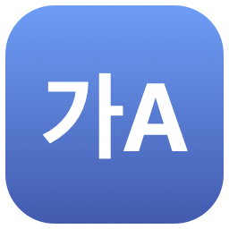

<h1 align="center">Catchtype 커뮤니티</h1>

> **이 저장소에는 Catchtype의 소스 코드가 없어요.** 질문·아이디어·소식을 나누는 [토론(Discussions)](https://github.com/hebbianai/catchtype-community/discussions)만 써요. Catchtype의 입력 엔진은 오픈 소스가 아니에요. 앱은 [catchtype.com](https://catchtype.com/?utm_source=github&utm_medium=referral&utm_campaign=community&utm_content=readme_notice)에서 받아요.
>
> **This repository has no Catchtype source code.** It is only for [Discussions](https://github.com/hebbianai/catchtype-community/discussions) (questions, ideas and news, mostly in Korean). Catchtype's input engine is not open source. [In English ↓](#in-english)

[Catchtype](https://catchtype.com/?utm_source=github&utm_medium=referral&utm_campaign=community&utm_content=readme_intro) 사용자 모임이에요. Catchtype은 한/영 키 없이 그냥 치면 한글과 영어를 알아서 바꿔 주는 입력 도구예요.

## 프라이버시

- **치는 키와 문장은 기기 밖으로 보내지 않아요.** 한국어인지 영어인지는 언제나 기기 안에서 판단해요. 지금은 계정도 없어요.
- 데스크톱 앱(macOS·Windows·Linux)은 하루 한 번 catchtype.com에 새 판이 있는지 물어요. 끄면 저절로 연결하지 않아요.
  - macOS: 설정 → 일반 → '하루 한 번 자동으로 업데이트 확인'
  - Windows·Linux: 메뉴의 '하루 한 번 자동으로 확인'
- iPhone·iPad 키보드에는 인터넷에 연결하는 코드가 없어요. Android 키보드에는 인터넷 권한이 없어요.
- 피드백은 보내기를 누를 때만 가요.
- 무엇을 언제 어디로 보내는지, 직접 확인하는 법: **[인터넷으로 보내는 것](docs/network.md)** · [English](docs/network.en.md) · [개인정보 처리방침](https://catchtype.com/privacy?utm_source=github&utm_medium=referral&utm_campaign=community&utm_content=readme_privacy)

## 받기

- macOS·Windows·Linux: [catchtype.com](https://catchtype.com/?utm_source=github&utm_medium=referral&utm_campaign=community&utm_content=readme_download#download). macOS는 터미널에서 `brew install --cask hebbianai/tap/catchtype`로도 받을 수 있어요. Linux는 [Linux에서 쓰기](https://catchtype.com/linux?utm_source=github&utm_medium=referral&utm_campaign=community&utm_content=readme_linux)를 봐 주세요.
- iPhone·iPad: [App Store](https://apps.apple.com/app/id6822543636)
- Android: [Google Play](https://play.google.com/store/apps/details?id=com.hebbianai.catchtype)

## 문제 알리기

이 저장소의 Issues는 꺼 두었어요. 이상하게 바뀐 말이나 버그는 아래로 보내 주시면 더 빨리 찾아요.

- 데스크톱 앱: 메뉴의 "피드백 보내기…" (Linux는 브라우저로 양식이 열려요)
- iPhone·Android 앱: 앱의 "문제 알리기"
- 사이트: [피드백 양식](https://catchtype.com/feedback?utm_source=github&utm_medium=referral&utm_campaign=community&utm_content=readme_feedback), [이상하게 바뀐 말 알리기](https://catchtype.com/report?utm_source=github&utm_medium=referral&utm_campaign=community&utm_content=readme_report)

이야기를 나누고 싶으면 카카오톡 [캐치타입(Catchtype) 사용자 모임](https://open.kakao.com/o/pamEH2Si)에도 오세요.

## 어디에 쓰면 되나요

- **Q&A**: 쓰다가 막힌 것, 설정 방법
- **Ideas**: 있었으면 하는 기능. 마음에 드는 아이디어에는 추천(👍)을 눌러 주세요. 추천이 많은 것부터 살펴봐요.
- **Show and tell**: 이렇게 쓰고 있어요, 잘 바뀐 예, 이상하게 바뀐 예
- **Announcements**: Catchtype 팀 소식(새 판, 고친 것)

## 글 올리기 전에

- 여기 쓴 글은 누구나 볼 수 있어요. 메일 주소, 전화번호, 비밀번호, 회사 안 글처럼 남에게 보이면 안 되는 것은 쓰지 마세요.
- 디버그 기록을 붙일 때는 안에 든 글을 먼저 읽어 보세요.
- 서로 존중해 주세요. 광고, 비방, 남의 개인정보는 지워요.

[개발 응원하기 ☕](https://buymeacoffee.com/catchtype?utm_source=github&utm_medium=referral&utm_campaign=coffee&utm_content=readme)

## In English

- **No source code here.** This repository is only for Discussions. Catchtype's input engine is not open source.
- **Privacy:** the keys you press and the text you type never leave your device. Korean or English is always decided on the device. Today there is no account.
- The desktop apps (macOS, Windows, Linux) ask catchtype.com once a day whether a new version is out. Turn it off and they do not connect on their own: on macOS, Settings → General → "Check for updates once a day"; on Windows and Linux, "Check Once a Day" in the menu.
- The iPhone and iPad keyboard has no code that connects to the internet. The Android keyboard has no internet permission.
- Feedback is sent only when you click Send.
- What is sent, when and where, and how to check it yourself: **[What Catchtype sends over the internet](docs/network.en.md)** · [Privacy Policy](https://catchtype.com/en/privacy?utm_source=github&utm_medium=referral&utm_campaign=community&utm_content=readme_privacy_en)
- Download: [catchtype.com](https://catchtype.com/en/?utm_source=github&utm_medium=referral&utm_campaign=community&utm_content=readme_download_en#download) (macOS, Windows, Linux), [App Store](https://apps.apple.com/app/id6822543636), [Google Play](https://play.google.com/store/apps/details?id=com.hebbianai.catchtype)
- Report a problem: "Send Feedback…" in the app menu, or the [feedback form](https://catchtype.com/en/feedback?utm_source=github&utm_medium=referral&utm_campaign=community&utm_content=readme_feedback_en).
- [Support development ☕](https://buymeacoffee.com/catchtype?utm_source=github&utm_medium=referral&utm_campaign=coffee&utm_content=readme_en)
